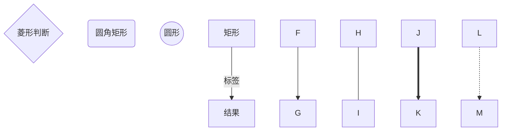
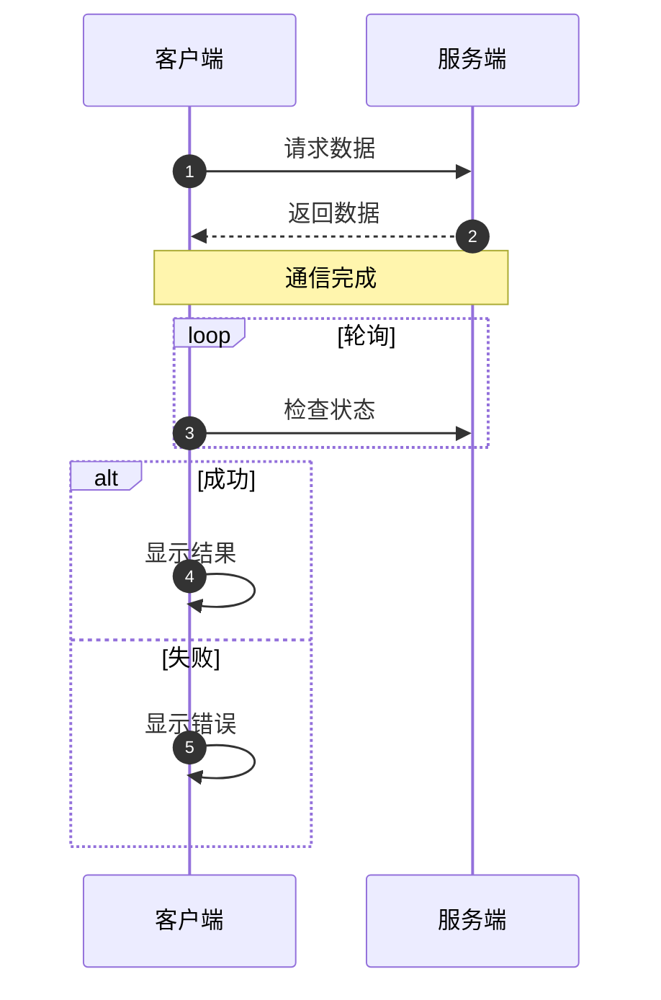
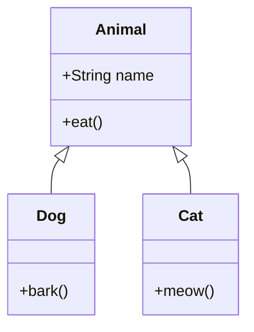
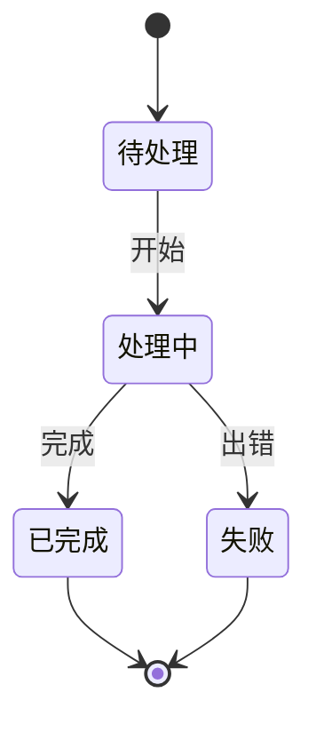
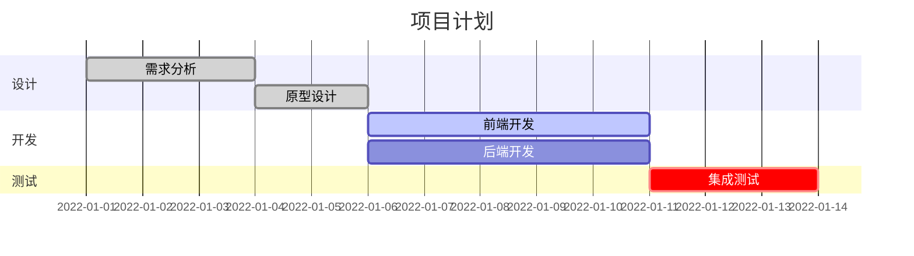
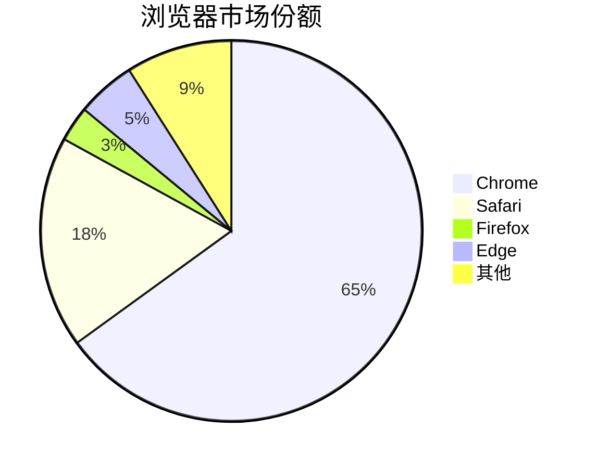
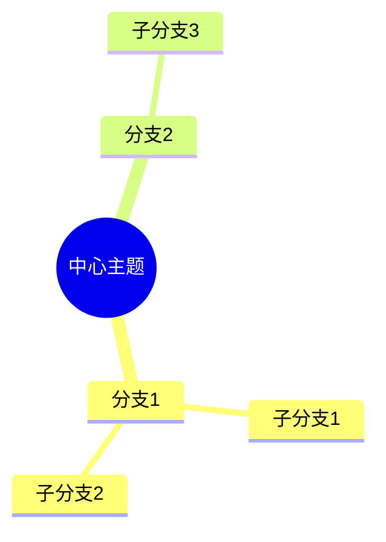

## Markdown语法

### Typora快捷键

| 快捷键                          | 作用                    | 快捷键                               | 作用                    |
| ------------------------------- | ----------------------- | ------------------------------------ | ----------------------- |
| **<kbd>Ctrl + F</kbd>**         | **搜索**                | **<kbd>Ctrl + H</kbd>**              | **替换**                |
| **<kbd>Ctrl + T</kbd>**         | **插入表格**            | **<kbd>Ctrl + Shift + K</kbd>**      | **插入代码块**          |
| **<kbd>Ctrl + B</kbd>**         | **加粗**                | **<kbd>Ctrl + I</kbd>**              | **倾斜**                |
| **<kbd>Ctrl + Shift + I</kbd>** | **插入图片**            | **<kbd>Ctrl + K</kbd>**              | **插入链接**            |
| **<kbd>Ctrl + /</kbd>**         | **源码/编辑模式切换**   | **<kbd>Ctrl + Shift + L</kbd>**      | **侧边栏显示/隐藏切换** |
| **<kbd>Ctrl + Shift + ]</kbd>** | **提升标题级别**        | **<kbd>Ctrl + Shift + [</kbd>**      | **降低标题级别**        |
| **<kbd>Ctrl + 1~6</kbd>**       | **插入1~6级标题**       | **<kbd>Ctrl + U</kbd>**              | **下划线**              |
| **<kbd>Ctrl + L</kbd>**         | **选中一整行**          | **<kbd>Ctrl + D</kbd>**              | **选中单词**            |
| **<kbd>Ctrl + Home</kbd>**      | **跳到文档头部**        | **<kbd>Ctrl + End</kbd>**            | **跳到文档底部**        |
| **<kbd>Ctrl + Enter</kbd>**     | **下方插入表格行**      | **<kbd>Ctrl + Shift + Delete</kbd>** | **删除表格当前行**      |
| **<kbd>Ctrl + Shift + M</kbd>** | **插入公式块**          | **<kbd>Ctrl + =</kbd>**              | **放大**                |
| **<kbd>Ctrl + Shift + 5</kbd>** | **插入删除线**          | **<kbd>Ctrl + -</kbd>**              | **缩小**                |

### 标题

```markdown
# 标题 1
## 标题 2
### 标题 3
#### 标题 4
##### 标题 5
###### 标题 6
```

- `#` 号后需要**空格**
- 也支持 `标题1` + `===` (一级) 或 `---` (二级) 的写法

### 段落与换行

- **段落**：空一行分隔
- **换行**：行末加**两个空格**或使用 `<br>`
- **分隔线**：三个或以上的 `---`、`***`、`___`

```markdown
这是第一段

这是第二段

第一行(末尾两个空格)  
第二行

---
***
```

### 文本样式

```markdown
*斜体* 或 _斜体_
**粗体** 或 __粗体__
***粗斜体*** 或 ___粗斜体___
~~删除线~~
<u>下划线</u>
==高亮/标记==
H~2~O (下标)
2^n^ (上标)
```

| 效果         | 语法               |
| ------------ | ------------------ |
| *斜体*       | `*斜体*`           |
| **粗体**     | `**粗体**`         |
| ***粗斜体*** | `***粗斜体***`     |
| ~~删除线~~   | `~~删除线~~`       |
| <u>下划线</u>| `<u>下划线</u>`    |
| ==高亮==     | `==高亮==`         |
| H~2~O        | `H~2~O`            |
| 2^n^         | `2^n^`             |

### 转义字符

- 使用反斜杠 `\` 转义特殊字符

```markdown
\*不是斜体\*
\# 不是标题
\[不是链接\]
```

| 需转义字符 | 说明       |
| ---------- | ---------- |
| `\`        | 反斜杠     |
| `` ` ``    | 反引号     |
| `*`        | 星号       |
| `_`        | 下划线     |
| `{}`       | 花括号     |
| `[]`       | 方括号     |
| `()`       | 圆括号     |
| `#`        | 井号       |
| `+`        | 加号       |
| `-`        | 减号       |
| `.`        | 英文句点   |
| `!`        | 感叹号     |

### 列表

#### 无序列表

```markdown
- 列表项
* 列表项
+ 列表项
```

#### 有序列表

```markdown
1. 列表项
2. 列表项
3. 列表项
```

#### 任务列表

```markdown
- [x] 已完成任务
- [ ] 未完成任务
```

#### 嵌套列表

```markdown
- 列表 1
    - 子列表
        - 子子列表
- 列表 2

1. 有序列表
    - 嵌套无序列表
2. 有序列表
```

- 缩进使用 **4个空格** 或 **1个Tab**

### 区块引用

```markdown
> 引用内容
>
> > 嵌套引用
> >
> > 可以包含 `代码`、**粗体** 等
```

> 引用内容
>
> > 嵌套引用

### 代码

#### 行内代码

```markdown
使用 `console.log()` 输出日志
```

#### 代码块

````markdown
```javascript
function test() {
    console.log("Hello");
}
```
````

- 使用三个反引号包裹，可指定语言实现**语法高亮**

#### 支持的代码语言(常用)

| 语言           | 标注           | 语言         | 标注         |
| -------------- | -------------- | ------------ | ------------ |
| JavaScript     | `javascript`   | TypeScript   | `typescript` |
| HTML           | `html`         | CSS          | `css`        |
| Java           | `java`         | Python       | `python`     |
| Go             | `go`           | C/C++        | `c` / `cpp`  |
| C#             | `csharp`       | PHP          | `php`        |
| SQL            | `sql`          | Shell        | `shell`      |
| JSON           | `json`         | YAML         | `yaml`       |
| XML            | `xml`          | Markdown     | `markdown`   |
| Vue            | `vue`          | React/JSX    | `jsx`        |
| Mermaid        | `mermaid`      | Flow         | `flow`       |
| Diff           | `diff`         | Dockerfile   | `dockerfile` |

### 链接

```markdown
[链接文字](https://example.com)
[链接文字](https://example.com "标题")
<https://example.com>
[引用链接][ref]

[ref]: https://example.com
```

#### 锚点链接

```markdown
[跳转到标题](#标题名)
```

- 标题名转小写，空格替换为 `-`
- 例：`## 我的标题` → `[链接](#我的标题)`

### 图片

```markdown


```

- 图片链接：`[](链接地址)`

### 表格

```markdown
| 左对齐 | 右对齐 | 居中对齐 |
| :----- | -----: | :------: |
| 单元格 | 单元格 | 单元格   |
| 单元格 | 单元格 | 单元格   |
```

| 对齐方式 | 语法       |
| -------- | ---------- |
| 左对齐   | `:-----`   |
| 右对齐   | `-----:`   |
| 居中     | `:----:`   |

#### 表格内特殊内容

```markdown
| 内容       | 示例                     |
| ---------- | ------------------------ |
| 行内代码   | `code`                   |
| 链接       | [文字](url)              |
| 换行       | 第一行<br>第二行         |
| 加粗       | **粗体**                 |
```

### 脚注

```markdown
这里有一个脚注[^1]

[^1]: 脚注内容
```

这里有一个脚注[^demo]

[^demo]: 这是脚注的内容

### 目录(TOC)

```markdown
[TOC]
<!-- 或 -->
[[toc]]
```

- 自动生成文档目录(根据标题层级)

### 数学公式

#### 行内公式

```markdown
$E = mc^2$
```

#### 公式块

```markdown
$$
\frac{n!}{k!(n-k)!} = \binom{n}{k}
$$
```

#### 常用LaTeX语法

| 语法                 | 效果               |
| -------------------- | ------------------ |
| `$x^2$`              | 上标               |
| `$x_2$`              | 下标               |
| `$\frac{a}{b}$`      | 分数               |
| `$\sqrt{x}$`         | 根号               |
| `$\sum_{i=1}^n$`     | 求和               |
| `$\alpha, \beta$`    | 希腊字母           |
| `$\neq, \leq, \geq$` | 不等号             |
| `$\infty$`           | 无穷大             |
| `$\times, \div$`     | 乘除号             |

### HTML嵌入

```markdown
<u>下划线</u>
<kbd>Ctrl</kbd> + <kbd>C</kbd>
<font color="red">红色文字</font>
<details>
    <summary>点击展开</summary>
    隐藏内容
</details>
```

#### 音频

```html
<audio controls>
    <source src="音频地址.mp3">
</audio>
```

#### 视频

```html
<video src="视频地址.mp4" controls style="width:100%"></video>
```

### Mermaid图表

#### 流程图

| 方向       | 语法       |
| ---------- | ---------- |
| 从上到下   | `graph TD` |
| 从下到上   | `graph BT` |
| 从左到右   | `graph LR` |
| 从右到左   | `graph RL` |



| 节点形状         | 语法           |
| ---------------- | -------------- |
| 矩形             | `A[文字]`      |
| 圆角矩形         | `A(文字)`      |
| 圆形             | `A((文字))`    |
| 菱形(判断)       | `A{文字}`      |
| 箭头形           | `A>文字]`      |

| 连线类型         | 语法           |
| ---------------- | -------------- |
| 实线箭头         | `A --> B`      |
| 带标签箭头       | `A -->|标签| B`|
| 粗线箭头         | `A ==> B`      |
| 虚线箭头         | `A -.-> B`     |
| 无箭头实线       | `A --- B`      |

#### 时序图

| 连线类型           | 语法     | 说明             |
| ------------------ | -------- | ---------------- |
| 实线无箭头         | `->`     | 消息             |
| 虚线无箭头         | `-->`    | 响应             |
| 实线有箭头         | `->>`    | 请求             |
| 虚线有箭头         | `-->>`   | 返回             |
| 实线末端叉         | `-x`     | 异步终止         |
| 虚线末端叉         | `--x`    | 异步返回         |



#### 类图



| 关系         | 语法     |
| ------------ | -------- |
| 继承         | `<|--`   |
| 实现         | `<|..`   |
| 组合         | `*--`    |
| 聚合         | `o--`    |
| 关联         | `-->`    |
| 依赖         | `..>`     |

#### 状态图



#### 甘特图



| 任务状态     | 说明       |
| ------------ | ---------- |
| `done`       | 已完成     |
| `active`     | 进行中     |
| `crit`       | 关键任务   |
| 默认         | 待开始     |

#### 饼图



#### 思维导图


