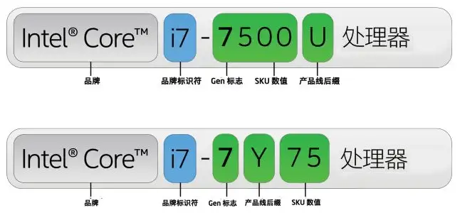
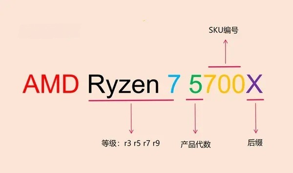

## CPU

### [查看天梯图](https://www.mydrivers.com/zhuanti/tianti/cpu/index.html)

### Intel

**性能: 至强(Xeon) > 酷睿(Core) > 奔腾(Pentium) > 赛扬(Celeron) > 凌动(Atom)**

#### 命名规则

>   **Intel Core i7-14700K**

| 命名部分    | 意义                                                    |
| ----------- | ------------------------------------------------------- |
| **Core i7** | 系列／性能等级（i3 入门 → i5 主流 → i7 高端 → i9 旗舰） |
| **14**      | 代数（14代）                                            |
| **700**     | SKU代号（同代中性能排名，高数字一般性能更强）           |
| **K**       | 后缀字母，代表特殊功能定位                              |

| 后缀        | 意义                                            |
| ----------- | ----------------------------------------------- |
| **K**       | 解锁倍频，可超频                                |
| **F**       | 无集成显卡（需独立显卡）                        |
| **KF**      | 既可超频又无集成显卡                            |
| **U**       | 超低功耗（轻薄本常见）                          |
| **H/HK/HX** | 高性能笔记本系列（HK/HX 多为更高性能/可超频版） |
| **T**       | 低功耗/低频率桌面版                             |
| **E**       | 嵌入式平台                                      |
| **G1-G7**   | 核显性能等级                                    |

#### 优点

- **性能高, 功耗低**
- **稳定, 兼容性好**
- **单核心性能强**

#### 缺点

- **价格高, 超频空间小**

### AMD

#### 命名规则

-   **AMD Ryzen 7 5800X**

| 命名部分            | 意义                                                         |
| ------------------- | ------------------------------------------------------------ |
| **Ryzen 7**         | 系列／性能等级（Ryzen 3 → Ryzen 5 → Ryzen 7 → Ryzen 9 越大性能越强） |
| **5**               | 代数（本例为 5 代，也是架构代数）                            |
| **800**             | SKU 排位（代内性能顺序）                                     |
| **X / X3D / F / G** | 后缀，代表特殊特性                                           |

| 后缀                | 意义                                                         |
| ------------------- | ------------------------------------------------------------ |
| **X**               | 主要用于桌面款，性能略高                                     |
| **X3D**             | 带 3D V-Cache 技术（大缓存，游戏性能更好）                   |
| **G**               | 搭载集成显卡（APU）                                          |
| **F**               | 桌面款但不带集成显卡                                         |
| **无后缀**          | 标准版，比如普通桌面 Ryzen CPU                               |
| **U / H / HS / HX** | 笔记本系列（**U**：低功耗；**H**：高性能；**HS/HX**：更高性能/可超频） |

#### 优点

- **价格低, 性价比高**
- **超频空间大**
- **多核心性能强**

#### 缺点

- **兼容性差**

## 显卡

### [查看天梯图](https://www.mydrivers.com/zhuanti/tianti/gpu/index.html)

### AMD

#### 命名规则

>   **AMD Radeon RX 7800 XT**

| 组成部分                    | 意义                                          |
| --------------------------- | --------------------------------------------- |
| **Radeon**                  | 品牌/产品线                                   |
| **RX**                      | 表示 Radeon 系列独显（主要面向游戏/消费市场） |
| **7**                       | 代数/系列（例如 6000、7000、9000 系列）       |
| **800**                     | 层级定位，数字越大性能越高                    |
| **GRE / XT / XTX / 无后缀** | 性能版本（无后缀 < GRE < XT < XTX）           |

### NVIDIA

#### 命名规则

>   **NVIDIA GeForce RTX 4090 Ti**

| 组成部分                | 意义                                               |
| ----------------------- | -------------------------------------------------- |
| **GeForce**             | 品牌/产品线（GeForce 代表游戏/消费级）             |
| **GTX / RTX**           | 系列标识（RTX 表示支持光追 Ray Tracing & AI 特性） |
| **40**                  | 世代/系列代数（40 系列是第四代）                   |
| **90**                  | 层级/档位（数字越大性能越强）                      |
| **Ti / Super / 无后缀** | 性能版本（无后缀 < Super < Ti）                    |

## 内存

### 品牌

| 西部数据 | 金士顿 | 美商海盗船 | 三星 | 影驰 | 威刚 | 联想 | 芝奇 |
| -------- | ------ | ---------- | ---- | ---- | ---- | ---- | ---- |

### 参数

| 参数              | 说明                                           |
| ----------------- | ---------------------------------------------- |
| **容量**          | 4G, 8G, 16G, 32G, 64G                          |
| **频率(MHz)**     | 2400, 2666, 3200, 3600, 4000, 6000, 7000, 7200 |
| **内存频速(DDR)** | DDR2, DDR3, DDR4, DDR5                         |

## 硬盘

### 品牌

| 西部数据 | 希捷 | 东芝 | 三星 | 金士顿 | 联想 | 闪迪 | 英睿达 |
| -------- | ---- | ---- | ---- | ------ | ---- | ---- | ------ |

### 参数

| 参数     | 说明                             |
| -------- | -------------------------------- |
| **容量** | 256GB, 500GB, 1TB, 2TB, 4TB, 8TB |
| **接口** | mSATA、SATA、PCIe、M.2               |
| **类别** | SSD, HDD                         |
| **用途** | 红盘, 绿盘, 黑盘, 蓝盘, 紫盘     |

> - **绿盘**：侧重于节能，性能相对一般，但适用于长期保存文件
> -  **黑盘**：侧重于高性能，性能佳，适用于电脑服务器以及对性能特殊要求的行业
> -  **蓝盘**：是介于绿盘和黑盘之间，通常用的就是蓝盘，性能适中
> -  **紫盘**：是录像设备专门设计的，适合365天×24小时不间断的运行
> -  **红盘**：是为NAS专用数据网络存储设计的

## 主板

### 品牌

| 华硕 | 微星 | 七彩虹 | 技嘉 | 铭瑄 | 华擎 | 影驰 |
| ---- | ---- | ------ | ---- | ---- | ---- | ---- |

### 类型

| 类型        | 说明                                                         |
| ----------- | ------------------------------------------------------------ |
| **E-ATX型** | **大板, X开头**                                              |
| **ATX型**   | **大板, 扩展性好，接口全，内存四插槽起，2或3个PCIe接口和M.2接口** |
| **M-ATX型** | **小板, 内存插槽两个或四个，一个M.2接口**                    |

## 机箱

### 品牌

| 追风者 | 联力 | 海盗船 | 酷冷至尊 | 先马 | 爱国者 | 金河田 | 安钛克 |
| ------ | ---- | ------ | -------- | ---- | ------ | ------ | ------ |

### 类型

| 类型          | 说明                                                   |
| ------------- | ------------------------------------------------------ |
| **全塔机箱** | 空间大，支持E-ATX/ATX主板，散热扩展性强，适合高端装机 |
| **中塔机箱** | 最常见类型，支持ATX/M-ATX主板，兼顾空间与体积         |
| **ITX机箱**  | 体积小巧，仅支持ITX主板，适合桌面/客厅摆放             |

### 选购要点

- **兼容性**：确认支持的主板类型（E-ATX/ATX/M-ATX/ITX）、显卡长度限制、CPU散热器高度限制
- **散热风道**：前置进风扇位、顶部/后部排风扇位数量，风道设计是否合理
- **走线空间**：背部走线空间是否充足，是否有线孔盖/理线槽设计
- **防尘设计**：是否配备可拆卸防尘网（顶部/底部/前面板）
- **扩展性**：硬盘位数量（3.5寸/2.5寸）、USB前置接口数量及类型

## 电源

### 品牌

| 海韵 | 振华 | 海盗船 | 安钛克 | 长城 | 航嘉 | 全汉 | 鑫谷 |
| ---- | ---- | ------ | ------ | ---- | ---- | ---- | ---- |

### 参数

| 参数           | 说明                                                                 |
| -------------- | -------------------------------------------------------------------- |
| **额定功率**   | 300W, 450W, 550W, 650W, 750W, 850W, 1000W, 1200W, 1600W             |
| **认证等级**   | 白牌, 铜牌, 银牌, 金牌, 白金牌, 钛金牌（80 PLUS认证，转换效率越高越好） |
| **模组化**     | 非模组（线材固定）、半模组（部分线材可拆）、全模组（所有线材可拆）   |
| **尺寸规格**   | ATX（标准大电源）、SFX（小电源，ITX机箱常用）                       |

### 选购要点

- **功率计算**：CPU TDP + 显卡 TDP + 其他硬件约50W，总功耗 × 1.3~1.5倍即为推荐电源瓦数
- **认证等级**：建议选择金牌及以上认证，转换效率高、发热低、省电
- **模组化选择**：全模组走线更整洁、方便理线，但价格更高；非模组性价比高
- **保护功能**：需具备过压保护(OVP)、过流保护(OCP)、短路保护(SCP)等
- **质保年限**：主流品牌一般提供5~10年质保，越长越好

## 显示器

### 品牌

| 三星 | LG   | AOC  | 微星 | 飞利浦 | 戴尔 | 华硕 | 联想 |
| ---- | ---- | ---- | ---- | ------ | ---- | ---- | ---- |

### 参数

| 参数             | 说明                                                                                       |
| ---------------- | ------------------------------------------------------------------------------------------ |
| **尺寸**         | 21.5寸, 23.8寸, 27寸, 32寸, 34寸(带鱼屏)                                                   |
| **分辨率**       | 1080P(FHD), 2K(QHD), 4K(UHD)                                                               |
| **面板类型**     | IPS（色彩好、可视角度大）、VA（对比度高、曲面常见）、TN（响应快、色彩差）                   |
| **刷新率**       | 60Hz, 75Hz, 144Hz, 165Hz, 240Hz, 360Hz（越高越流畅，游戏推荐144Hz以上）                    |
| **响应时间**     | 1ms, 5ms（越低越拖影少，游戏推荐1ms）                                                      |
| **色域**         | sRGB, Adobe RGB, DCI-P3（数值越高色彩越丰富，设计推荐100% sRGB或更高）                     |
| **接口**         | HDMI, DisplayPort(DP), Type-C, VGA（注意显卡与显示器接口匹配）                             |
| **曲率**         | 平面, 1800R, 1500R, 1000R（数字越小弯曲越大，曲面沉浸感强）                                |

### 选购建议

- **办公/日常**：23.8寸/27寸 + 1080P/2K + IPS面板 + 60~75Hz，价格实惠
- **游戏玩家**：27寸 + 2K + IPS/VA + 144Hz以上 + 1ms响应
- **设计/影视**：27寸以上 + 4K + IPS + 100% sRGB/DCI-P3 + 色准ΔE<2
- **带鱼屏**：34寸超宽屏，适合多窗口办公/沉浸式游戏/视频剪辑时间线

## 鼠标

### 品牌

| 罗技 | 雷蛇 | 赛睿 | 卓威 | 双飞燕 | 达尔优 | 微软 | 华硕 |
| ---- | ---- | ---- | ---- | ------ | ------ | ---- | ---- |

### 分类

| 类型       | 说明                                           |
| ---------- | ---------------------------------------------- |
| **办公鼠标** | 轻便舒适，DPI适中，续航长，适合长时间办公       |
| **游戏鼠标** | 高精度传感器，高DPI，多按键可编程，响应快       |
| **人体工学鼠标** | 垂直/轨迹球设计，减少腕部压力，适合长时间使用 |

### 核心参数

| 参数           | 说明                                                         |
| -------------- | ------------------------------------------------------------ |
| **DPI/CPI**    | 鼠标灵敏度，数值越高移动越快，游戏鼠标一臋800~25600+         |
| **传感器**     | 光学传感器（主流）、激光传感器（精度高但价格贵）             |
| **回报率**     | 125Hz, 500Hz, 1000Hz, 4000Hz, 8000Hz（越高响应越及时）       |
| **重量**       | 轻量级(<70g)、中等(70~100g)、重型(>100g)，游戏推荐轻量化     |
| **连接方式**   | 有线（延迟最低）、无线2.4G（低延迟）、蓝牙（省电但延迟稍高） |
| **按键数**     | 办公2~5键、游戏5~12键（侧键可编程）                          |

## 键盘

### 品牌

| 海盗船 | 罗技 | 雷蛇 | 赛睿 | 达尔优 | 杜伽 | FILCO | 燃风 |
| ------ | ---- | ---- | ---- | ------ | ---- | ----- | ---- |

### 轴体类型

| 轴体     | 特点                                                   |
| -------- | ------------------------------------------------------ |
| **青轴** | 段落感强，声音清脆，打字节奏感好，但噪音大，不适合宿舍 |
| **红轴** | 线性手感，无段落感，轻盈顺滑，游戏/办公均适合           |
| **茶轴** | 轻微段落感，介于青轴与红轴之间，万能轴，适合新手入门   |
| **黑轴** | 线性手感，压力较大，触发快，适合游戏玩家               |
| **银轴** | 线性手感，触发行程极短，响应极快，竞技游戏首选         |

### 核心参数

| 参数           | 说明                                                         |
| -------------- | ------------------------------------------------------------ |
| **轴体**       | 机械轴（青/红/茶/黑/银等）、薄膜、静电容                     |
| **配列**       | 104/108键(全尺寸)、87键(TKL)、68键、60%配列等               |
| **连接方式**   | 有线、无线2.4G、蓝牙（支持多设备切换）                       |
| **热插拔**     | 支持热插拔可自行更换轴体，无需焊接                           |
| **背光**       | 无光、单色背光、RGB背光                                     |
| **键帽材质**   | ABS（轻便易打油）、PBT（耐磨不易打油，推荐）               |

## 音响

### 品牌

| 漫步者 | 惠威 | JBL | 哈曼卡顿 | 索尼 | 创新 | 声擎 | 马歇尔 |
| ------ | ---- | --- | -------- | ---- | ---- | ---- | ------ |

### 分类

| 类型             | 说明                                                   |
| ---------------- | ------------------------------------------------------ |
| **2.0有源音箱** | 左右两个音箱，内置功放，适合桌面近场聆听、办公         |
| **2.1音箱**     | 两个卫星箱 + 一个低音炮，低音更强，适合游戏/影音       |
| **5.1/7.1音箱** | 多声道环绕声系统，适合家庭影院                         |
| **回音壁**       | 条形音箱，体积小巧，可挂墙，适合客厅电视搭配           |

### 选购要点

- **使用场景**：桌面近场选2.0有源箱，游戏/影音选2.1，家庭影院选5.1以上
- **功率**：桌面10~30W足够，客厅建议50W以上
- **接口**：3.5mm、USB、蓝牙、光纤、同轴，注意与电脑/电视接口匹配
- **音质参数**：频响范围越宽越好（如50Hz~20kHz），信噪比≥80dB

## 耳机

### 品牌

| 索尼 | 森海塞尔 | 铁三角 | 博世 | 苹果 | 三星 | 漫步者 | 硕美科 |
| ---- | -------- | ------ | ---- | ---- | ---- | ------ | ------ |

### 分类

| 类型             | 说明                                                   |
| ---------------- | ------------------------------------------------------ |
| **头戴式**       | 包耳/压耳设计，音场大、隔音好，适合游戏/音乐           |
| **入耳式**       | 塞入耳道，便携隔音好，适合通勤/运动                   |
| **半入耳式**     | 放置在耳道口，佩戴舒适不压迫，适合长时间佩戴           |
| **骨传导**       | 不堵塞耳朵，通过颅骨传音，适合运动/户外，安全不隔绝环境音 |

### 核心参数

| 参数           | 说明                                                         |
| -------------- | ------------------------------------------------------------ |
| **连接方式**   | 有线（3.5mm/USB）、无线蓝牙（5.0/5.3，延迟低、稳定性好）   |
| **降噪**       | 主动降噪(ANC)、被动降噪、通透模式                           |
| **频响范围**   | 20Hz~20kHz（人耳可听范围），越宽表现力越强                   |
| **阻抗**       | 低阻抗(<50Ω)易驱动，高阻抗(>100Ω)需耳放                     |
| **续航**       | 无线耳机一般20~40小时，充电盒可额外提供多次充电               |
| **麦克风**     | 带麦款可通话，游戏耳机推荐带可拆卸降噪麦                     |

## 摄像头

### 品牌

| 罗技 | 奥尼 | 海康威视 | 海康萤石 | 微软 | 联想 | 华硕 | 海雀 |
| ---- | ---- | -------- | -------- | ---- | ---- | ---- | ---- |

### 核心参数

| 参数           | 说明                                                         |
| -------------- | ------------------------------------------------------------ |
| **分辨率**     | 720P, 1080P(FHD), 2K, 4K（越高画面越清晰，直播/会议推荐1080P以上） |
| **帧率**       | 30fps, 60fps（越高画面越流畅，直播/游戏推荐60fps）           |
| **对焦方式**   | 自动对焦(AF)、手动对焦(MF)、定焦                             |
| **视角**       | 60°, 78°, 90°, 120°（广角镜头可拍摄更大范围）               |
| **接口**       | USB-A, USB-C（即插即用，注意接口版本兼容性）                 |
| **麦克风**     | 内置双麦克风/降噪麦克风，视频会议更清晰                     |

### 选购建议

- **视频会议**：1080P + 30fps + 自动对焦 + 内置降噪麦，满足日常需求
- **直播/录制**：2K/4K + 60fps + 大光圈 + 低光补偿，画质更专业
- **隐私保护**：选择带物理镜头盖/隐私挡片的型号

## 麦克风

### 品牌

| 舒尔 | 铁三角 | 罗德 | 得胜 | 森海塞尔 | 蓝鸸 | 飞乐 | 奥睿 |
| ---- | ------ | ---- | ---- | -------- | ---- | ---- | ---- |

### 分类

| 类型             | 说明                                                   |
| ---------------- | ------------------------------------------------------ |
| **USB麦克风**   | 即插即用，内置声卡，适合直播/会议/录音入门             |
| **电容麦克风** | 灵敏度高、音质细腻，适合录音棚/播客/ASMR，需48V幻象供电 |
| **动圈麦克风** | 耐用、抗噪强，适合现场演出/播客/游戏直播，不需幻象供电 |
| **领夹麦克风** | 小巧便携，夹在衣领处，适合采访/教学/视频录制           |

### 核心参数

| 参数           | 说明                                                         |
| -------------- | ------------------------------------------------------------ |
| **指向性**     | 心形指向（只收前方声音，最常用）、全指向、双指向、枪式       |
| **频响范围**   | 20Hz~20kHz，越宽音质表现越好                                 |
| **灵敏度**     | 数值越高拾音越灵敏，电容麦一般高于动圈麦                     |
| **接口**       | USB（即插即用）、XLR（专业接口，需搭配声卡）                 |
| **采样率/位深** | 44.1kHz/16bit, 48kHz/24bit, 96kHz/24bit（越高音质越好）     |

### 选购建议

- **游戏直播**：USB心形指向电容麦/动圈麦，即插即用，降噪好
- **播客/录音**：XLR电容麦 + 独立声卡，音质最佳
- **会议/教学**：USB全指向麦/领夹麦，拾音范围广
- **户外/采访**：无线领夹麦，便携不受线缆限制

## 桌椅

### 品牌

| 永艺 | 西昊 | 保友 | 震旦 | 黑白调 | 网易严选 | 傲风 | 迪卡侬 |
| ---- | ---- | ---- | ---- | ------ | -------- | ---- | ------ |

### 人体工学椅

| 参数           | 说明                                                         |
| -------------- | ------------------------------------------------------------ |
| **椅背材质**   | 网布（透气，推荐）、海绵（柔软）、皮质（高档但透气差）       |
| **头枕**       | 可调节高度/角度，支撑颈椎，缓解颈部疲劳                     |
| **腰托**       | 可调节腰靠，贴合腰椎曲线，保护腰部                         |
| **扶手**       | 1D/2D/3D/4D可调扶手（上下/前后/左右/旋转），适配不同坐姿   |
| **座垫**       | 海绵座垫（舒适）、网布座垫（透气），注意座深是否可调         |
| **气压棒**     | 认准SGS/BIFMA认证的四级气压棒，安全可靠                     |
| **底盘**       | 钢制五星脚，承重能力强，万向轮顺滑不伤地板                 |

### 电脑桌

| 类型             | 说明                                                   |
| ---------------- | ------------------------------------------------------ |
| **普通电脑桌**   | 固定高度，结构简单，价格实惠                           |
| **升降桌**       | 电动/手动调节高度，坐站交替，保护脊椎，推荐             |
| **L型电脑桌**   | 转角设计，桌面空间大，适合多显示器/办公+游戏双用         |
| **电竞桌**       | 带RGB灯效、碳纤维桌面、理线孔、耳机挂钩等游戏元素       |

### 选购建议

- **椅子**：长时间使用必须选人体工学椅，关注腰托/头枕/扶手可调性，气压棒必须有安全认证
- **桌子**：推荐电动升降桌，高度可调范围70~120cm，桌面深度≥60cm，承重≥100kg
- **搭配**：椅子与桌子高度需匹配，双脚平放地面、大腿与地面平行、手臂自然90°弯曲为最佳坐姿

## 其他配件

### 散热系统

| 类型             | 说明                                                         | 品牌推荐                                   |
| ---------------- | ------------------------------------------------------------ | ------------------------------------------ |
| **风冷散热器** | 风扇 + 金属散热片，性价比高，安装简单                       | 利民、酷冷至尊、猫头鷹、九州风神           |
| **水冷散热器** | 液体循环散热，散热性能强，适合高功耗CPU，分一体式和分体式   | 海盗船、恩杰、利民、瓦尔基里               |
| **机箱风扇**   | 辅助机箱内部风道循环，注意尺寸(120mm/140mm)与风量/噪音平衡 | 利民、猫头鷹、酷冷至尊                     |

### 存储配件

| 配件             | 说明                                                         |
| ---------------- | ------------------------------------------------------------ |
| **移动硬盘**     | 便携存储，机械式(便宜/怕摔)或固态式(快速/抗震)，推荐SSD   |
| **U盘**           | 小巧便携，USB 3.0以上传输速度快，适合小文件/文档传输         |
| **存储卡**       | SD卡/TF卡，用于相机/手机/掌机等设备扩展存储                 |
| **硬盘盒**       | 将内置硬盘转为移动硬盘使用，注意接口匹配(SATA/NVMe)         |

### 网络设备

| 配件             | 说明                                                         |
| ---------------- | ------------------------------------------------------------ |
| **路由器**       | WiFi 6/WiFi 7，关注带机量、覆盖面积、是否支持Mesh组网       |
| **网卡**         | 主板无WiFi需单独购买，PCIe网卡或USB无线网卡，推荐WiFi 6E以上 |
| **交换机**       | 扩展有线网口数量，适合多设备/多房间有线连接                 |

### 其他常用配件

| 配件             | 说明                                                         |
| ---------------- | ------------------------------------------------------------ |
| **UPS不间断电源** | 断电时提供临时供电，保护数据不丢失，适合重要工作/服务器     |
| **理线器/扎线带** | 整理线缆，保持桌面整洁                                     |
| **屏幕挂灯**     | 挂在显示器上方，不占桌面空间，减少屏幕反光，保护眼睛         |
| **USB集线器**   | 扩展USB接口数量，注意选择带独立供电的型号                 |
| **散热底座**     | 笔记本专用，辅助散热，降低温度                             |

## 购买注意事项

### 兼容性

1. **CPU与主板必须匹配**：Intel和AMD的CPU不能混用，且不同代CPU对应不同插槽（如Intel LGA1700、AMD AM5），需确认主板插槽与CPU一致
2. **内存与主板兼容**：DDR4与DDR5内存不兼容，需确认主板支持的内存类型和最高频率
3. **机箱与主板尺寸匹配**：ITX机箱只能装ITX主板，中塔机箱支持ATX/M-ATX，全塔支持E-ATX/ATX
4. **电源功率充足**：电源额定功率应大于整机功耗的1.3倍以上，留足余量
5. **显卡与机箱兼容**：确认机箱支持的显卡长度限制，大型三风扇显卡可能需要长机箱
6. **散热器与机箱兼容**：确认机箱支持的CPU散热器高度限制，以及主板插槽是否兼容

### 选购技巧

7. **内存条最好选偶数条**：比如想要16GB，就买`2条8GB`组成双通道，性能比单条更好
8. **内存频率不宜过高**：内存频率需主板和CPU同时支持，过高会降频，选择主板/CPU支持的最高频率即可
9. **SSD做系统盘，HDD做存储盘**：固态硬盘速度快适合装系统和常用软件，机械硬盘容量大适合存储文件
10. **电源不要省钱**：劣质电源可能损坏其他硬件，选择知名品牌、80 PLUS金牌认证以上、5年质保以上的产品
11. **显示器接口与显卡匹配**：确认显卡输出接口（HDMI/DP/Type-C）与显示器输入接口一致，否则需要转接器
12. **注意散热**：高功耗CPU/GPU必须配好的散热器，否则会导致降频、卡顿甚至死机

### 避坑指南

13. **警惕二手/翻新硬件**：非正规渠道的CPU、显卡、内存可能是矿卡/翻新货，建议选择官方渠道或知名电商平台
14. **不要只看跑分**：实际体验比跑分更重要，关注游戏帧数、软件响应速度等真实场景表现
15. **注意保修政策**：各硬件保修年限不同，CPU/主板/电源一般3~5年，内存/SSD一般5~10年，保留好购买凭证
16. **系统盘容量不宜太小**：256GB仅够装系统，建议至少512GB，推荐1TB SSD
17. **不要忽视线材质量**：劣质数据线/电源线可能导致传输不稳定/安全隐患，选择品牌线材
18. **静电防护**：装机前先触摸金属物体释放静电，或佩戴防静电手环，避免静电损坏硬件
