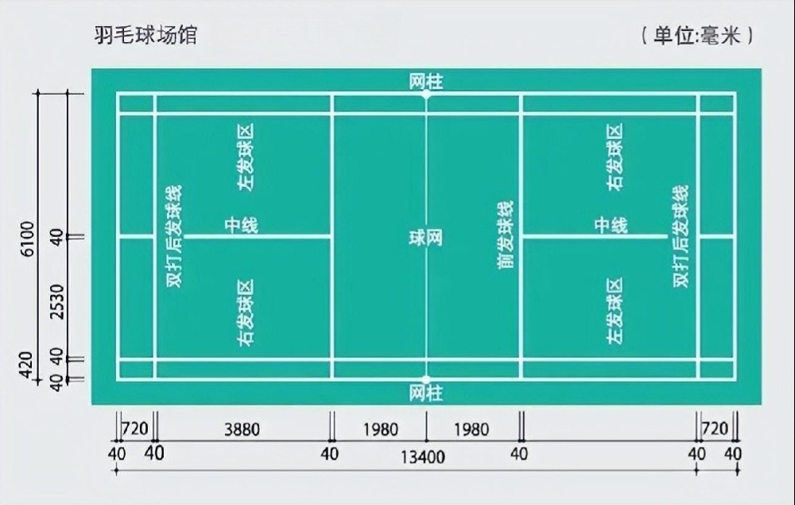
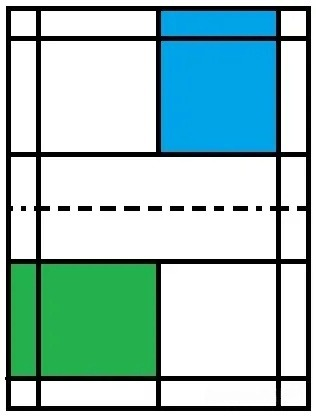
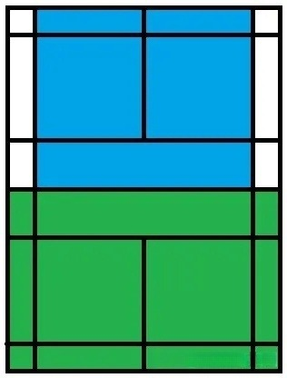

## 羽毛球

这份笔记用于理解规则、选择装备和安排业余练习。学习顺序以握拍、移动、稳定击球为基础，再加入落点、攻防转换和战术，不以杀球速度或穿线磅数衡量水平。

> 规则核对日期：2026-11-03。下文同时说明当前21分制和已公布的2027年15分制。具体比赛可能采用经批准的其他赛制或提前实施新制，参赛前须确认赛事规程。

### 球场与界线

| 项目 | 标准尺寸 |
| :--- | :--- |
| 球场全长 | 13.40米 |
| 双打场地宽 | 6.10米 |
| 单打场地宽 | 5.18米 |
| 网顶高度 | 中央1.524米，双打边线处1.55米 |
| 短发球线 | 距球网1.98米 |
| 双打后发球线 | 距后端线0.76米 |
| 场地线宽 | 40毫米，界线属于其界定的区域 |

不要将“网高1.55米”理解为整张球网各处高度都相同。

#### 发球范围

| 项目 | 左右边界 | 前后边界 |
| :--- | :--- | :--- |
| 单打发球 | 单打边线，较窄 | 短发球线至后端线，较长 |
| 双打发球 | 双打边线，较宽 | 短发球线至双打后发球线，较短 |

发球须进入对角接发球区；压到相应有效区域的界线算界内。图中的颜色只作辅助，判断时以线名和实际赛制为准。

#### 回合中的击球范围

- 单打回合使用单打边线与后端线。
- 双打发球后，回合使用双打边线与后端线，后方有效范围比双打发球区更长。
- 羽毛球首次落地的位置决定落点，不能以落地后羽毛展开或弹动的位置判断。

### 计分与比赛流程

#### 当前21分制

- 通常三局两胜，每回合获胜方得1分。
- 一局先到21分者获胜；20平后须领先2分，29平时先到30分者获胜。
- 一局胜方下一局先发球；比赛开始前通过挑边等正式流程决定先发球／接发球或选择场区。
- 领先一方到11分时，局中间歇不超过60秒；局间间歇不超过120秒。
- 每局结束交换场区；第三局有一方先到11分时再次交换场区。

#### 已公布的15分制

BWF于2026年4月通过三局两胜15分制，计划自**2027-01-04**实施；部分国家或赛事可有自己的提前实施安排。

| 项目 | 21分制 | 新15分制 |
| :--- | :--- | :--- |
| 常规目标分 | 21分 | 15分 |
| 平分后须领先2分的起点 | 20平 | 14平 |
| 封顶 | 30分，29平后一球决定 | 21分，20平后一球决定 |
| 局中间歇节点 | 领先方到11分 | 领先方到8分 |
| 第三局交换场区节点 | 一方到11分 | 一方到8分 |

来源：[日本羽协：BWF通过15分制及实施日期](https://www.badminton.or.jp/news/detail/2156)、[瑞典羽协：新制具体规则与当地提前实施安排](https://badminton.nu/nyheter/nyheter/2026-05-21-nytt-raknesatt-infors-fran-sasongen-2026-2027)。

### 发球、接发与常见判罚

#### 发球基本要求

- 发球员与接发球员站在对角发球区内，不踩各自发球区界线。
- 从发球开始到发出时，双方双脚均须有一部分与地面接触并保持规定的静止状态。
- 按BWF标准高度规则，击球瞬间整个球须低于场地表面1.15米；不能仅用“低于腰部”代替此标准。
- 放球时不得主动施加旋转，球拍须先击中球托；挥拍向前的动作应连续完成，不以停顿假动作拖延。
- 发球擦网后若仍合法落入对角发球区，不因“擦网”自动重发。
- 地方比赛适用的替代发球规定，须事先查看规程。

#### 单打发球位置

以**发球方本局得分**判断：偶数分从右区发球，奇数分从左区发球。发球方赢回合后换区继续发；接发方赢回合后得分并取得发球权。

#### 双打发球轮转

- 同样按发球方得分的奇偶确定本次发球应在右区还是左区。
- 发球方赢回合，由同一发球员换到另一侧继续发球。
- 接发方赢回合后得1分并取得发球权，不因刚得分就自动交换本方站位；由当前处于对应发球区的球员发球。
- 只有对角指定接发球员能接发，搭档不能代接。
- 发球结束后双方可在各自场区自由移动；每人并没有固定的“终身左区／右区”。

#### 常见情况

| 情况 | 判断要点 |
| :--- | :--- |
| 球压线 | 对应有效界线算界内，先确认是发球还是回合边界 |
| 球触及身体或衣物 | 回合中属于违例情况 |
| 球拍或身体触网 | 球仍在比赛中时触网属于违例情况 |
| 越网击球 | 初始触球应在本方；合法随挥过网与主动伸到对方场区击球不同 |
| 连击与持球 | 不允许托住后再抛出，或同方依次击球；同一次挥拍连续触及拍框与拍线不宜简单等同两次挥击 |
| 外来球进入场地 | 停止争抢并由裁判按干扰、重发球等规则处理，业余场先确保安全 |

场地、发球和判罚依据：[BWF《羽毛球竞赛规则》2025版](https://extranet.bwf.sport/docs/document-system/81/1466/1470/Section%204.1%20-%20Laws%20of%20Badminton%20-%2026%20April%202025%20V5.0%20%282%29%20.pdf)。正式争议由裁判按完整规则处理。

### 装备选择

#### 品牌与购买顺序

常见品牌包括尤尼克斯（YONEX）、李宁、威克多（VICTOR）、凯胜、亚狮龙及提供室内运动鞋的亚瑟士等。品牌定位与在售产品会变化，按具体型号、试用和售后判断。

优先考虑合脚防滑的室内鞋、可控的球拍和适配场地的球，再考虑高端拍、特殊线材与其他配件。

#### 球拍参数

| 参数 | 含义 | 选择思路 |
| :--- | :--- | :--- |
| 重量 | 常用U等级表示空拍重量 | 同时考虑穿线、底胶和手胶后的实际重量 |
| 平衡点 | 从拍柄底端至重心的距离 | 只描述静态分布，不等于完整挥重或挥拍速度 |
| 挥重 | 转动时的惯性表现 | 相同重量的两支拍也可能有不同挥动感 |
| 中杆硬度 | 受力弯曲及回弹特性 | 是否匹配发力节奏，比单纯追求硬杆更重要 |
| 手柄尺寸 | 常以G等级标识 | 不同品牌标法不统一，缠胶后实际握持最重要 |
| 长度与拍框 | 影响挥动、触球和操作 | 结合技术、身高及规则要求判断 |
| 推荐磅数 | 厂家对具体拍型的穿线范围 | 不超过球拍规定范围，结合线材和个人能力 |

#### 重量与手柄

| 常见标识 | 常见空拍重量范围，约值 |
| :--- | :--- |
| 2U | 90至不足95克 |
| 3U | 85至不足90克 |
| 4U | 80至不足85克 |
| 5U | 75至不足80克 |

同一套常见U标法通常数字越大越轻，但厂商可能直接标平均重量，选购时以产品说明为准。轻拍不等于一定省力，过轻也可能影响击球稳定与手感。

G号不能跨品牌直接换算成固定毫米数；部分品牌较大的G号代表较细手柄，但应以实际标识、底胶及缠胶后的手感确认。

#### 平衡与中杆

- 头重拍往往带来较明显的拍头惯性，也会增加启动和连续防守的负担。
- 头轻拍通常更容易快速操控，但实际击球表现还取决于总重、挥重和动作。
- 不将290毫米、300毫米等位置当作所有拍型的统一性能分界，手胶和穿线会改变实测平衡。
- 硬杆不必然力量更大、球速更快；软杆也不必然控制更好。发力不足或节奏不匹配都可能影响效果。

#### 球线、磅数与手胶

- 更高张力通常带来更直接的触球反馈，也可能降低容错；不是技术升级的必经路线。
- 线径、材质、穿线工艺和掉磅都会影响手感，不能只记一个磅数。
- 初学者从厂商允许范围内较易驾驭的设定开始，记录落点、击球深度和舒适度，再小幅调整。
- 手胶用于吸汗和改善握持，不要厚到妨碍手指控制；潮湿、打滑或明显磨损时更换。
- 球拍标称最大磅数是结构或保修相关指标，不是要求使用者必须穿到该值。

球拍重量、握柄和建议张力的型号差异可参考：[YONEX官方产品目录示例](https://www.yonex.com/media/wysiwyg/2024-Yonex-Badminton-Catalog.pdf)。

#### 球鞋与羽毛球

- 球鞋关注合脚、侧向稳定、抓地和急停支撑，不只看缓震厚度；跑鞋的设计取向不等于适合横向移动。
- 检查鞋底磨损、鞋面包裹和系带，避免在湿滑或有沙尘的场地打球。
- 羽毛球与合成材料球的飞行、耐用度和击球手感不同，练习或比赛尽量使用一致的球种。
- 球速标识受厂商、温度和海拔影响，先试球，不把某个数字视为所有场地都适用。
- 球明显摇摆、破损或速度异常时更换，不靠自行掰羽毛作为所有比赛的通用调速方法。

### 基础技术

#### 握拍与发力

- 正手基础握拍与反手拇指握拍需要能够自然切换，不将握柄长期握死。
- 非击球阶段适当放松，触球时结合手指控制与完整动作发力。
- 高远、杀球等头顶击球涉及下肢、躯干、肩臂和前臂协调，不只是“猛甩手腕”。
- 反手拇指握拍适合部分身前击球，后场反手等技术还需要不同握法和动作细节。
- 先在慢速喂球中找到合适触球位置，再增加速度和力量。

#### 步法

| 环节 | 练习重点 |
| :--- | :--- |
| 准备 | 身体平衡，重心可移动，拍子处于可反应位置 |
| 启动 | 配合对手触球时机做小幅分腿启动，不是一直原地跳 |
| 移动 | 根据距离组合并步、交叉步与跨步，不机械规定只能一种 |
| 到位 | 尽量先建立稳定位置再击球，不只伸手追球 |
| 跨步 | 控制落地和身体平衡，避免只顾伸远而无法回位 |
| 回位 | 依据自己回球和对手位置调整，不是每拍都跑到几何中心 |

先慢速无球练习，再加入固定落点，最后加入判断和随机移动。速度提高后若动作明显变形，应降低难度。

#### 常用击球

| 技术 | 主要用途 | 入门关注 |
| :--- | :--- | :--- |
| 高远球 | 将球送到对方后场，争取调整时间 | 到位、触球点、出球深度 |
| 吊球 | 从后场将球送向前场 | 与高远球准备动作的连贯性、落点 |
| 杀球 | 向下压迫对手，创造后续机会 | 稳定与落点先于盲目发力 |
| 挑球 | 从前场将球送往后场 | 击球空间、深度与恢复站位 |
| 放网 | 使球过网后尽快下落 | 拍面、触球和步法配合 |
| 推球 | 快速送向空当或对手身后 | 提前取点，控制线路 |
| 平抽挡 | 中前场快速平击与拦挡 | 小动作、换握和拍子准备 |
| 接杀 | 化解向下进攻，争取转换 | 稳定触球、选择挡网或挑后场 |
| 发球与接发 | 建立第一拍和后续主动 | 合法性、落点和第三拍准备 |

技术学习参考：[BWF Shuttle Time教师手册](https://www.badminton.org.au/wp-content/uploads/2022/11/1.-BWF-ST-Teachers-Manual_Inclusivity_ENGLISH.pdf)。具体动作宜结合示范和教练反馈校正。

### 单打与双打思路

#### 单打

- 先保证回球质量，减少无准备时的冒险进攻。
- 用前后、左右调动创造空间，不为变化而变化。
- 被动时优先争取恢复时间和位置，主动时再压缩对手时间。
- 根据自己的回球线路调整站位，观察对方触球点和可用线路。

#### 双打

- 形成主动下压时常采用前后配合，承受下压时常采用左右防守；这是基本组织方式，不是固定站位命令。
- 由来球、搭档位置和本方回球共同决定轮转，不按性别固定前后场职责。
- 中路球提前约定沟通方式，避免双方同时挥拍或都不接。
- 接发、第三拍和连续衔接很重要，不只练习后场杀球。
- 减少无质量的挑球，同时避免为了“不起球”勉强处理而直接失误。

### 练习安排

#### 一次60分钟的安排示例

| 时间 | 内容 | 目标 |
| :--- | :--- | :--- |
| 10分钟 | 逐渐升温、关节活动与轻量步法 | 从低强度进入运动状态 |
| 10分钟 | 握拍切换、发球与固定落点 | 稳定动作与触球 |
| 15分钟 | 一项击球技术配合移动 | 先到位，再控制落点 |
| 15分钟 | 有限制条件的对练或小场景 | 将技术用于选择与衔接 |
| 5分钟 | 低强度整理 | 逐步降低运动强度 |
| 5分钟 | 记录问题 | 明确下次练习重点 |

时长与组数按体能和恢复情况调整，不把示例当作必须完成的训练量。

#### 递进方法

1. 无球慢动作，确认握拍与移动顺序。
2. 固定位置、固定落点喂球，提高稳定性。
3. 加入移动，但保留可预测的来球。
4. 增加两点或多点选择，再进入随机对练。
5. 最后在比赛中检验，记录失误是判断、移动还是击球问题。

每次选择一两个目标，使用落点成功率、连续稳定回合数或录像对比记录进步，不一次同时修改所有动作。

### 运动安全与常见误区

- 场前检查地面、鞋底、空间及球拍状态，捡球前观察相邻球场。
- 刚开始或长时间停练后逐步增加强度，避免直接进行大量跳杀和极限救球。
- 双打呼叫要清楚，避免从搭档身后突然抢球；击球前留意挥拍空间。
- 明显疼痛、眩晕或不适时停止活动，持续问题寻求专业评估，不靠护具或忍痛维持强度。

| 误区 | 调整方向 |
| :--- | :--- |
| 杀得越重越好 | 先保证到位、落点和下一拍衔接 |
| 只需要手腕发力 | 练习全身协调与手指控制 |
| 每拍回到场地正中心 | 根据球路和局面选择合理回位 |
| 双打始终一前一后 | 随攻防状态和来球轮转 |
| 拍越硬、磅越高水平越高 | 装备匹配动作和能力，不追求参数本身 |
| 买高端拍就能解决失误 | 先分清失误是否来自动作、移动或判断 |
