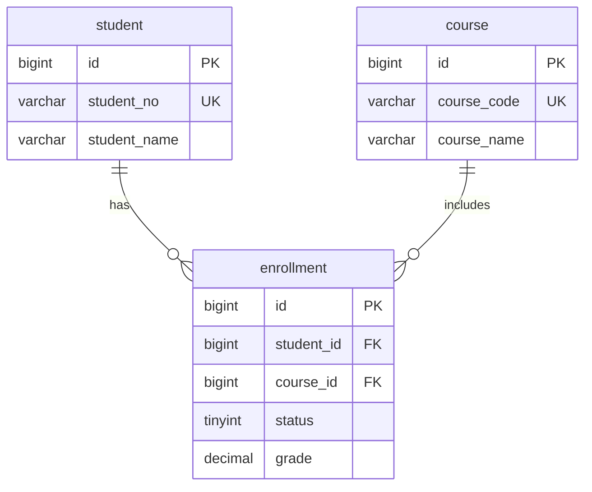

## 数据库设计

数据库设计的目标是准确表达业务规则、保护数据一致性，并让主要读写操作在可维护的结构上运行。先确定数据与规则，再选择表、字段和索引，不从“每张表都套一组标准字段”开始。

> 整理日期：2026-11-03。建模与范式部分讨论一般关系型设计；SQL、排序规则、索引及执行计划示例以**MySQL 8.4／InnoDB**为背景。其他数据库须核对其类型、NULL、索引与事务语义。文中的SQL是学习示例，未连接数据库执行。

### 设计流程

| 阶段 | 需要回答的问题 | 产出 |
| :--- | :--- | :--- |
| 需求分析 | 谁读写数据，必须保存什么，哪些规则不能违反 | 用例、业务规则及典型查询 |
| 概念设计 | 有哪些实体，实体之间是什么关系 | 实体关系图和基数 |
| 逻辑设计 | 每行代表什么，如何唯一标识，字段依赖谁 | 表、候选键、关系与约束 |
| 物理设计 | 类型、索引、字符集和存储如何选择 | 目标数据库DDL及查询方案 |
| 验证 | 正常、边界、并发和规模变化时是否正确 | 约束检查、执行计划及性能证据 |
| 演进 | 如何上线变更、迁移旧数据和处理失败 | 版本化迁移与恢复方案 |

### 先定义业务规则

建表前至少明确：

- **记录粒度**：一行代表一个用户、一笔订单，还是一次状态变更。
- **唯一范围**：编号是全局唯一、租户内唯一，还是某一业务周期内唯一。
- **必填与可选**：没有值是尚未录入、不适用，还是不允许出现。
- **关系数量**：一个对象可关联多少个另一类对象，是否允许暂时没有关联。
- **历史要求**：保存当前状态还是每次变化；修改基础资料是否应影响历史记录。
- **查询与写入**：主要筛选条件、排序、分页、批处理及并发写入方式。
- **生命周期**：删除、恢复、归档、保留期限和权限边界。

例如“学生选课”必须先说明是否允许重修、是否区分学期和教学班，才能确定选课记录的唯一键。不要在需求未定义时，默认学生与课程永远只能关联一次。

### 实体、键与关系

#### 键的概念

| 概念 | 说明 |
| :--- | :--- |
| 超键 | 能唯一标识记录的一组属性，可能含多余属性 |
| 候选键 | 最小的超键，移除任一属性后不再能保证唯一 |
| 主键 | 从候选键中选出的主要标识，在SQL中要求唯一且非NULL |
| 备用键 | 未被选为主键的其他候选键，通常由唯一及必要的非空约束表达 |
| 自然键 | 来自业务的标识，如业务规则保证唯一的学号 |
| 代理键 | 额外生成的技术标识，如自增ID或UUID |
| 外键 | 限制引用值必须对应被引用键，保护引用完整性 |

- 每张业务表宜有明确、稳定的标识；加一个自增ID不能替代业务唯一约束。
- 单列代理主键不会自动消除其他候选键上的函数依赖问题。
- InnoDB聚簇索引使用主键组织记录，二级索引还保存主键值，因此主键宽度及写入分布会影响成本。
- 自增整数、UUID或其他ID方案各有集中生成、分布式生成、长度和排序等取舍，不一律禁止字符串主键，也不一律要求BIGINT自增。

#### 一对一

常见于账号主体与可选扩展资料：一个账号对应零或一条资料，一条资料属于一个账号。

- **共享主键**：扩展表的主键同时作为指向主体表的外键。
- **独立主键**：扩展表有自身主键，主体ID列再加`UNIQUE`及外键。
- 外键加唯一能表达“最多一条”，不能单独保证“每个主体必须有一条扩展记录”。后者还需要写入流程等保证。
- 同生命周期、同权限、经常一起读取的数据，可以放在一张表中，不必为了满足一对一而拆表。

#### 一对多

在“一名学生当前只属于一个班级”的假设下，班级对学生是一对多。

- 将`class_id`放在学生这一侧，指向班级键。
- 是否允许`NULL`，取决于是否允许尚未分班。
- 是否可删除班级、是否保留学生历史归属，需要另行定义。

#### 多对多

学生与课程通过选课表关联，关系本身可以具有状态、成绩、选课时间等属性。

- 中间表保存双方外键，按业务唯一范围选择联合主键或额外唯一约束。
- 增加代理ID后，仍须防止同一业务关系重复插入。
- 若区分学期或教学班，唯一范围应包含对应实体，不能只约束学生与课程。

### 数据表范式

范式依据**业务规则下的函数依赖和候选键**判断，不是看当前几行数据碰巧没有重复。其目的是减少冗余及插入、更新、删除异常。

#### 第一范式（1NF）

属性在所采用的关系模型中取单一值，不使用重复列组或一个字段编码多条应独立管理的关系。“原子性”取决于建模语义，不是要求字符串或日期永远不能再拆。

| 不合适的结构 | 问题 | 调整 |
| :--- | :--- | :--- |
| 一个字段存多个课程编号，以逗号分隔 | 难以约束每个课程、关联和去重 | 建选课表，每条关系一行 |
| 使用`phone_1`、`phone_2`、`phone_3`表示任意多个号码 | 数量扩展需要修改表结构 | 需要任意多个号码时建联系方式子表 |
| 将整段自由文本作为备注 | 不一定有问题 | 如果业务只需整体保存，可保留文本 |

显式主键是重要工程实践，但不能把“是否写了PRIMARY KEY”作为1NF的唯一判定标准。JSON也不自动等于设计错误，应看其是否承载需要独立约束、关联和查询的核心关系。

#### 第二范式（2NF）

满足1NF，且每个非主属性完全依赖于每个候选键，不存在对候选键真子集的部分依赖。主属性指属于任一候选键的属性。

假设一名学生对一门课程只保留一条选课记录，候选键为`(student_no, course_code)`：

| 字段 | 依赖关系 | 是否存在部分依赖 |
| :--- | :--- | :--- |
| 学生姓名 | `student_no → student_name` | 是，仅依赖联合键中的学号 |
| 课程名称 | `course_code → course_name` | 是，仅依赖联合键中的课程编号 |
| 成绩 | `(student_no, course_code) → grade` | 在该业务假设下依赖完整联合键 |

拆分为：

- `student(student_no, student_name)`。
- `course(course_code, course_name)`。
- `enrollment(student_no, course_code, grade)`。

不能用一个会重复的“学生编号主键”示例来解释联合键的部分依赖，也不能仅加代理ID就认为冗余已经解决。

#### 第三范式（3NF）

入门理解：在2NF基础上，非主属性不应经由其他非主属性传递依赖候选键。

例如业务规定每名学生属于一个班级，每个班级有一个当前名称：

`student_id → class_id → class_name`

将班级名称放在每条学生记录上，会让更名操作重复发生。可拆成学生表保存`class_id`，班级表保存`class_id`与`class_name`。

更严格的定义：对于每个非平凡函数依赖`X → A`，`X`是超键，或`A`是主属性。复杂的多候选键场景不能只靠“所有字段依赖主键”的口诀判断。

#### BCNF与反范式

- BCNF进一步要求每个非平凡函数依赖的决定因素都是超键，适用于需要继续分析的复杂依赖关系。
- 先建立清楚的一致性模型，再根据真实查询和测量决定是否冗余。
- 冗余必须定义权威来源、更新方式、失败补偿和校验机制，不因“少一次JOIN”就默认值得。
- 订单成交价、下单时收货地址等历史快照表达的是当时的事实，不是当前商品价格或用户地址的随意副本。

参考：[Microsoft：规范化基础](https://learn.microsoft.com/en-us/office/troubleshoot/access/database-normalization-description)。

### 约束与数据完整性

| 约束 | 作用 | 注意点 |
| :--- | :--- | :--- |
| `PRIMARY KEY` | 唯一标识记录 | 非空，不替代其他业务唯一性 |
| `UNIQUE` | 防止业务键重复 | NULL及大小写比较语义因数据库和排序规则不同 |
| `NOT NULL` | 禁止缺失值 | 不代表字符串非空或数值有效 |
| `CHECK` | 限制当前行的取值条件 | 不能替代跨行、跨表的全部业务校验 |
| `FOREIGN KEY` | 限制引用关系 | 定义删除、更新行为并考虑索引和事务 |
| `DEFAULT` | 插入时省略字段的默认值 | 只在业务有合理默认时使用，不为全部字段强塞空串或零 |

#### 外键取舍

- 同一关系数据库内，外键是保护引用完整性的常见手段，不应默认禁止。
- 应用负责业务校验和友好提示，数据库约束保护最终不变量；两者并不冲突。
- InnoDB要求外键列具有适用索引，缺少时可能自动创建；仍应检查最终索引定义和查询需求。
- `RESTRICT`等阻止破坏引用的操作，`CASCADE`会连带修改或删除，`SET NULL`要求列可空；按生命周期选择。
- 如果分库、跨服务等确实不能使用数据库外键，需要明确补偿、巡检、删除协调和并发处理成本。

#### NULL与唯一性

- `NULL`通常用于表达未知、未填写或不适用，应在字段定义中说明具体含义。
- 使用`IS NULL`／`IS NOT NULL`判断，不能用`= NULL`替代。
- MySQL允许可空唯一索引中存在多个NULL；空字符串不是NULL，重复空字符串仍可能触发唯一冲突。
- `NOT IN`的比较集合含NULL时可能得到未知结果，不能按普通“排除列表”直觉处理。
- MySQL的`CHECK`表达式为TRUE或UNKNOWN时可通过，因此要求必填时仍需要`NOT NULL`。

来源：[MySQL：外键约束](https://dev.mysql.com/doc/refman/8.4/en/create-table-foreign-keys.html)、[CHECK约束](https://dev.mysql.com/doc/refman/8.4/en/create-table-check-constraints.html)、[唯一与其他索引](https://dev.mysql.com/doc/refman/8.4/en/create-index.html)。

### 字段类型与命名

#### 类型选择

| 数据 | 选择思路 |
| :--- | :--- |
| 整数与ID | 根据实际范围、增长和关联类型选择，不机械统一为最小类型或BIGINT |
| 学号、手机号、邮编 | 按标识字符串处理，保留前导零、国家码及非数值语义 |
| 金额 | 用精确DECIMAL或有明确币种和单位的整数，同时规定舍入方式 |
| 测量近似值 | 可用FLOAT／DOUBLE，但评估精度，不用于要求精确的货币运算 |
| 定长／变长文本 | 根据数据分布、语义、比较及存储需求选CHAR／VARCHAR |
| 长文本与JSON | 按查询、大小、修改频率和约束需求选择，不一律禁止 |
| 时间 | 区分日期、当地日程、绝对时间点、时区和精度 |
| IP地址 | 同时考虑IPv4和IPv6；MySQL可选VARBINARY(16)配合转换函数，不能一律INT |
| 图片与大文件 | 通常放对象存储并保存键、大小、类型等元信息；小型二进制是否入库按事务和规模评估 |

- VARCHAR长度在MySQL中按字符声明，实际字节成本受字符集影响；长度依据业务上限设置。
- 整数字段的有无符号和范围须与外键目标一致，不能只看类型名相同。
- MySQL的DATETIME和TIMESTAMP在范围、时区转换等方面不同；选定后统一应用与数据库会话的时间约定。
- BIGINT等数值跨JavaScript和JSON边界时还要考虑整数精度，可约定以字符串传输ID。

#### 命名与字符集

- 统一小写及下划线等项目风格，名称表达业务含义，避免含糊缩写和保留字。
- 单数或复数都可，重点是整个项目一致；没有“表名必须不超过三个单词”的通用规则。
- 关联字段可采用`student_id`等明确名称，约束及索引名称宜能看出用途。
- 对字段单位、状态值、NULL语义和敏感程度写清注释及数据字典。
- MySQL中文和多语言文本通常选择`utf8mb4`；排序规则应按大小写、重音及业务唯一性要求决定。
- 示例中的`utf8mb4_0900_ai_ci`不区分大小写与重音，并非所有数据库版本和业务都适用。
- 用户名、外部编码、令牌等可能需要不同的比较策略，不将一种默认排序规则套用于全部字段。

### 贯穿示例：学生选课

为简化示例，约定：学生学号唯一；课程编号唯一；每个学生对每门课程只保留一条记录，退选和重新选择更新该记录；暂不建模学期、教学班和重修历史。



以下DDL以MySQL 8.4为例。实际项目先确定数据库、迁移编号和命名冲突处理，再执行；不使用此示例直接覆盖已有表。

```sql
CREATE TABLE student (
    id BIGINT UNSIGNED NOT NULL AUTO_INCREMENT COMMENT '学生ID',
    student_no VARCHAR(32) NOT NULL COMMENT '学号',
    student_name VARCHAR(100) NOT NULL COMMENT '姓名',
    created_at DATETIME(3) NOT NULL DEFAULT CURRENT_TIMESTAMP(3)
        COMMENT '创建时间，按应用统一时间约定写入',
    PRIMARY KEY (id),
    UNIQUE KEY uk_student_no (student_no)
) ENGINE=InnoDB DEFAULT CHARSET=utf8mb4
  COLLATE=utf8mb4_0900_ai_ci COMMENT='学生';

CREATE TABLE course (
    id BIGINT UNSIGNED NOT NULL AUTO_INCREMENT COMMENT '课程ID',
    course_code VARCHAR(32) NOT NULL COMMENT '课程编号',
    course_name VARCHAR(100) NOT NULL COMMENT '课程名称',
    PRIMARY KEY (id),
    UNIQUE KEY uk_course_code (course_code)
) ENGINE=InnoDB DEFAULT CHARSET=utf8mb4
  COLLATE=utf8mb4_0900_ai_ci COMMENT='课程';

CREATE TABLE enrollment (
    id BIGINT UNSIGNED NOT NULL AUTO_INCREMENT COMMENT '选课记录ID',
    student_id BIGINT UNSIGNED NOT NULL COMMENT '学生ID',
    course_id BIGINT UNSIGNED NOT NULL COMMENT '课程ID',
    status TINYINT UNSIGNED NOT NULL DEFAULT 1
        COMMENT '0退选，1已选，2已完成',
    grade DECIMAL(5, 2) NULL COMMENT '成绩；NULL表示尚未录入',
    created_at DATETIME(3) NOT NULL DEFAULT CURRENT_TIMESTAMP(3)
        COMMENT '首次创建时间',
    updated_at DATETIME(3) NOT NULL DEFAULT CURRENT_TIMESTAMP(3)
        ON UPDATE CURRENT_TIMESTAMP(3) COMMENT '最近修改时间',
    PRIMARY KEY (id),
    UNIQUE KEY uk_enrollment_student_course (student_id, course_id),
    KEY idx_enrollment_course (course_id),
    KEY idx_enrollment_student_status_created
        (student_id, status, created_at, id),
    CONSTRAINT fk_enrollment_student FOREIGN KEY (student_id)
        REFERENCES student (id) ON DELETE RESTRICT,
    CONSTRAINT fk_enrollment_course FOREIGN KEY (course_id)
        REFERENCES course (id) ON DELETE RESTRICT,
    CONSTRAINT chk_enrollment_status CHECK (status IN (0, 1, 2)),
    CONSTRAINT chk_enrollment_grade CHECK (grade BETWEEN 0 AND 100)
) ENGINE=InnoDB DEFAULT CHARSET=utf8mb4
  COLLATE=utf8mb4_0900_ai_ci COMMENT='学生选课';
```

设计说明：

- 代理ID与学生、课程的业务唯一键分工不同，不能互相替代。
- 选课联合唯一约束防止重复关系；未来支持多学期时须调整模型和唯一范围。
- `grade`可空，0分与尚未录入是不同状态；CHECK限制已填写的成绩范围。
- 删除学生或课程会受引用限制，避免无意清除选课记录。
- 状态、成绩、完成时间之间更完整的业务关系尚未建模，不能把简化示例当作完整教务系统。
- 身份验证不是本示例范围；实际账号系统保存合适的密码哈希，不保存明文或可逆加密密码作为登录验证依据。

### 索引设计

#### 从查询出发

1. 收集主要查询及调用频率、响应目标、过滤条件和排序。
2. 估计数据分布及每次实际需要返回的行数。
3. 设计支持过滤、连接、排序或覆盖读取的索引。
4. 用执行计划和真实规模数据验证收益。
5. 同时测量写入、空间和维护成本，再决定保留或删除。

索引不只用于“百万行大表”，也不是每个WHERE字段都单独建一个索引。

#### 联合索引与覆盖索引

| 概念 | 理解 |
| :--- | :--- |
| 联合B-tree索引 | 列顺序影响可用于查找和排序的方式 |
| 最左前缀 | `(a, b, c)`通常支持从a开始的连续前缀定位；不等同于SQL条件书写顺序 |
| 范围条件 | 可能限制后续列继续用于定位或排序，但后续列仍可能用于过滤或覆盖 |
| 覆盖读取 | 查询需要的数据可由索引提供，减少读取表记录的成本 |
| 区分度 | 需结合分布、查询比例和联合条件判断，低区分度不代表永远没用 |
| 冗余索引 | `(a)`可能被`(a,b)`覆盖用途，但还要比较宽度、唯一性和实际负载 |
| 前缀索引 | 可减少长字符串索引体积，但影响精确覆盖、排序及唯一性语义 |

示例查询与上文索引对应：

```sql
EXPLAIN
SELECT id, course_id, status, created_at
FROM enrollment
WHERE student_id = 1 AND status = 1
ORDER BY created_at DESC, id DESC
LIMIT 20;
```

- `(student_id, status, created_at, id)`先匹配学生和状态，再支持稳定排序。
- `id`作为同时间记录的排序补充，避免只按可能重复的时间值分页。
- 该二级索引没有`course_id`，此查询不能仅凭该索引就断言覆盖，需结合实际计划。
- 深分页可根据稳定排序设计游标条件，不能认为加LIMIT就没有扫描成本。

参考：[MySQL：联合索引](https://dev.mysql.com/doc/refman/8.4/en/multiple-column-indexes.html)。

#### 不再使用“固定失效清单”

| 说法 | 更准确的判断 |
| :--- | :--- |
| 不等号、NOT IN、IS NOT NULL必定不走索引 | 是否选择索引取决于条件、数据分布、可空语义和成本 |
| 对列使用函数必定无解 | 普通索引可能难以用于原样定位，可改写条件或评估表达式索引等能力 |
| 不满足最左前缀就完全没用 | 普通定位受限，但可能存在索引扫描、覆盖或特定优化，查看实际计划 |
| OR必须改成UNION ALL | 可能有索引合并等方案；改写还可能产生重复记录和语义差异 |
| EXISTS一定比IN快 | 优化器可能采用相近的半连接等策略，先确认语义再测量 |
| JOIN超过三张表一定很慢 | 行数、连接条件、索引、分布和执行策略比固定表数更有意义 |

以查询语义与执行计划为依据，不把关键字当作性能好坏的直接判据。[MySQL：IN／EXISTS与半连接优化](https://dev.mysql.com/doc/refman/8.4/en/semijoins-antijoins.html)。

### 查询计划与性能验证

| 观察项 | 说明 |
| :--- | :--- |
| `key` | 最终采用的索引，不只看候选索引 |
| `type` | 访问方式，不能脱离返回量和查询目标机械排名 |
| `rows`、`filtered` | 估计扫描量及过滤比例，不是实际耗时 |
| `Extra` | 覆盖读取、额外过滤、排序等信息 |
| 实际执行统计 | 结合耗时、实际行数、循环次数及资源使用 |

- `EXPLAIN`用于观察计划；`EXPLAIN ANALYZE`会实际执行所分析语句，使用前评估语句和负载。
- 全表扫描对小表或返回大部分记录的查询可能合理，不必强迫所有查询使用索引。
- `Using filesort`不直接等于落盘，也不直接代表需要优化；应看规模和成本。
- 测试应覆盖接近实际的数据分布、参数和并发，空表上的计划不能代表生产负载。
- 只查询需要的字段，避免无必要的大结果集；批量导出、统计和在线分页的设计目标不同。

来源：[MySQL：EXPLAIN及EXPLAIN ANALYZE](https://dev.mysql.com/doc/refman/8.4/en/explain.html)。

### 事务、并发与状态

- 将必须同时成功的数据库操作放在明确事务边界内，失败时完整回滚。
- 唯一性不能只靠“先查不存在再插入”，并发下仍须唯一约束及冲突处理。
- 涉及库存、名额或余额时，明确使用条件更新、行锁或版本校验等方式保护不变量。
- 事务并不自动避免所有竞态；隔离级别、锁的范围和访问顺序都影响结果。
- 处理死锁或冲突时采用有界重试，并确保重复执行不会重复产生业务效果。
- 跨数据库或外部服务的操作另设计幂等、消息及补偿流程，不能默认单库事务覆盖全部系统。
- 当前状态和状态历史分开定义；`updated_at`只能表示最近变动，不是完整审计日志。

### 删除、历史与归档

| 方式 | 适用考虑 | 需要额外处理 |
| :--- | :--- | :--- |
| 物理删除 | 确实不再保留的记录 | 引用关系、保留义务和恢复方案；不保证磁盘文件立即缩小 |
| 逻辑删除 | 业务需要撤销、恢复或隐藏 | 查询过滤、权限、唯一性、关联及恢复冲突 |
| 归档 | 冷热分离或长期留存 | 访问方式、校验、恢复及归档后业务关系 |
| 历史快照／变更记录 | 保存过去事实或审计 | 记录粒度、访问权限、不可变性和保留期限 |

- 逻辑删除不是生产环境的统一必选项，也不是独立备份。
- `UNIQUE(email, deleted_at)`在MySQL中**不能保证活跃行唯一**：当`deleted_at`为NULL时，可存在多条同邮箱记录。
- 需要“仅未删除数据唯一”时，应按数据库能力设计生成列、部分唯一索引或其他明确方案，并测试恢复及并发冲突；这些方案不跨数据库直接通用。
- 数据保留与清理按业务和适用要求确定，不无限保存全部已删除个人信息。

### 容量与架构演进

- 不以“500万行”“10GB”作为必须分库分表的通用门槛。
- 先测量查询、索引体积、内存、IO、写入、锁竞争及备份恢复时间。
- 行大小限制与页大小、行格式、页外存储、字符集等相关，不能概括为“任何记录绝不能超过8KB”。
- 先评估查询及索引、归档、实例资源和读写组织，再考虑分区或分片。
- MySQL分区不等于多实例分片，仍有唯一键、外键及操作限制须核对。
- 日志、事件、搜索和业务记录的存储按访问模式、留存和一致性决定，不一律排除MySQL，也不默认全部迁移到搜索引擎。

参考：[MySQL：InnoDB限制及行存储边界](https://dev.mysql.com/doc/refman/8.4/en/innodb-limits.html)。

### 变更与验证清单

#### 变更流程

1. 将DDL与数据迁移纳入版本管理，记录目标版本和执行顺序。
2. 增加唯一、非空或外键约束前，先检查重复、缺失和孤儿数据。
3. 评估锁、表重建、磁盘、复制延迟及新旧应用兼容性，不能默认ALTER完全在线无影响。
4. 必要时先扩展结构、分批回填、校验切换，再移除旧结构。
5. 提前定义失败恢复；MySQL中许多DDL存在隐式提交，不能仅依赖事务ROLLBACK恢复表结构变更。

#### 完整性验证

- [ ] 每张表的记录粒度、候选键与唯一范围明确。
- [ ] 同一业务关系不能被并发重复写入。
- [ ] 不存在指向无效主体的引用。
- [ ] NULL、空串、零、默认值和状态值有清晰区别。
- [ ] 删除、恢复和历史查询符合预期。
- [ ] 金额单位、时间约定、字符集和比较规则明确。
- [ ] 合法数据可写入，重复、越界和无效引用能按预期被拒绝。

#### 性能与维护验证

- [ ] 主要查询有对应执行计划和接近实际规模的数据验证。
- [ ] 索引收益与写入、空间成本都经过评估。
- [ ] 事务边界、并发冲突、重试和幂等有定义。
- [ ] 变更包含兼容、回填、校验及失败处理步骤。
- [ ] 备份能实际恢复，监控能发现慢查询和异常增长。

### 官方参考资料

- [MySQL 8.4参考手册](https://dev.mysql.com/doc/refman/8.4/en/)
- [数据类型](https://dev.mysql.com/doc/refman/8.4/en/data-types.html)
- [字符集与排序规则](https://dev.mysql.com/doc/refman/8.4/en/charset.html)
- [外键约束](https://dev.mysql.com/doc/refman/8.4/en/create-table-foreign-keys.html)
- [CHECK约束](https://dev.mysql.com/doc/refman/8.4/en/create-table-check-constraints.html)
- [联合索引](https://dev.mysql.com/doc/refman/8.4/en/multiple-column-indexes.html)
- [执行计划](https://dev.mysql.com/doc/refman/8.4/en/explain.html)
- [隐式提交语句](https://dev.mysql.com/doc/refman/8.4/en/implicit-commit.html)
